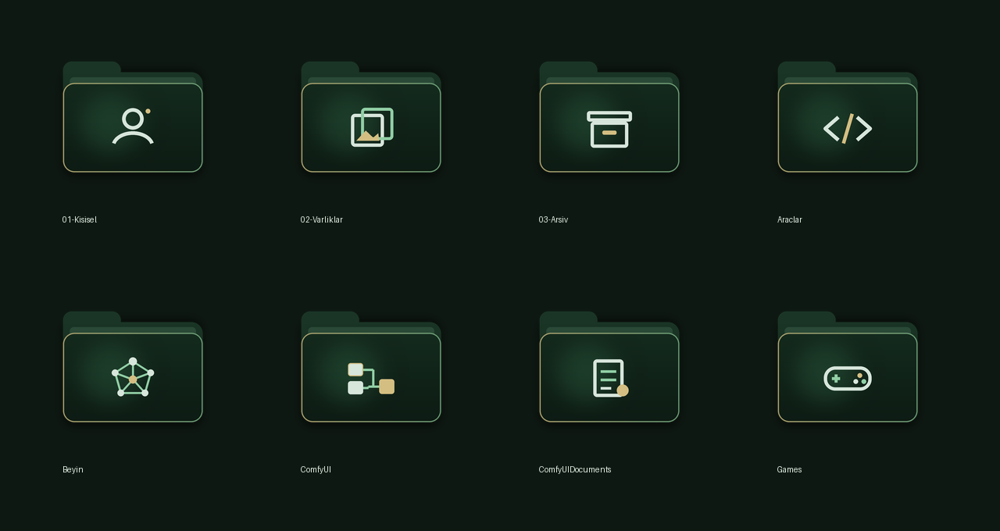

# 🎨 SplendThemeBuilder (Doom Control Center v3.0)

> **Zero-dependency Windows 10/11 Native Theme Studio, 10-bit HDR Explorer Glass Engine, 8-Widget Desktop HUD & System Boost Suite**  
> Built purely in C# (.NET Framework 4.x) with custom double-buffered GDI+ vector rendering, 32-bit ARGB layered windows (`WS_EX_LAYERED`), and native Win32/DWM P/Invoke — **no Electron, no WebView2, no external runtime dependencies.**



---

## ✨ Key Features (v3.0 — Bento Command Deck)

### 1. 🏛️ Bento Command Deck UI & Global Command Palette
- **Collapsible Left Icon Rail (`64px ↔ 224px`):** Spring-animated active indicator, custom vector glyphs, and quick-access Boost/Chameleon actions.
- **Persistent Top Telemetry Header:** Live **24-sample sparklines** for CPU %, RAM GB, and 10-bit HDR state, plus global Undo (`Ctrl+Z`) and Apply controls.
- **Live Mini Desktop Preview (`16:10`):** Real-time scaled preview of your wallpaper, Explorer window glow, taskbar/dock, HUD widgets, and a **Before/After split slider** with SDR/10-bit HDR simulation.
- **Global Command Palette (`Ctrl+Shift+Space`):** Fuzzy search across commands (`>`), themes (`#`), and HUD widgets (`@`) with instant keyboard execution.

### 2. 🎨 Color, Chameleon & 10-bit HDR Engine
- **Chameleon Palette Extractor:** Extracts 6 dominant swatches from any wallpaper in **OKLab** color space and auto-generates matching UI/Explorer/Taskbar themes.
- **Color Harmony Studio:** Generates 5-color palettes (`Mono`, `Analog`, `Complement`, `Triad`, `Split`, `Tetrad`) with live **WCAG 2.1 Contrast Matrix** checking and auto-contrast balancing.
- **360° Explorer Glow & 10-bit HDR White-Text Guard:** Hardware-friendly layered neon border/shadow daemon (`DoomGlassDaemon`) for File Explorer + **scRGB White-Text Guard** (`nits` clamp) so GDI text stays razor-sharp in Windows 10-bit HDR mode.
- **Dynamic `256px` `.ico` Generator:** Procedurally renders multi-resolution (`16px`–`256px`) folder icons tailored to your active theme palette.

### 3. 📊 8-Widget Layered Desktop HUD (`WS_EX_LAYERED`)
Click-through, draggable, snap-aligned 32-bit ARGB desktop widgets:
1. **Clock & Date**
2. **System / CPU / GPU Telemetry**
3. **Storage & Drives**
4. **Network Traffic**
5. **Media / Now Playing**
6. **Quick Notes & Uptime**
7. **Live Audio Spectrum Visualizer (`WASAPI` + `256-sample Radix-2 FFT`):** Supports `Bars`, `Mirror`, `Wave`, and `Radial Ring` styles with peak-hold physics.
8. **Pomodoro & Deep Focus Ring Timer:** Circular progress ring (`25/5/15` or `50/10`), session dots, and desktop/studio controls.

### 4. 🚀 Game/Render Boost & Display Center
- **Smart Focus Auto-Pause:** Automatically detects fullscreen games or heavy GPU workloads (`ComfyUI`, `Blender`, `Python`, etc.) and drops HUD/glow timers to **zero-overhead sleep mode**.
- **RAM & WorkingSet Purger:** One-click `EmptyWorkingSet` memory cleaner with freed MB reporting.
- **Display Dimmer & Kelvin Night-Light Overlay:** Software brightness dimmer (`0–80%`) and `2700K–6500K` warmth filter across monitors without requiring DDC/CI.
- **1-Click Desktop Icons Toggle:** Instantly hide or restore desktop icons.
- **`.doomtheme` Preset Packager & 20-Step Snapshot Rollback:** Export/import full theme configurations with validation and diff summaries.

---

## 🗂️ Architecture

| Module | Responsibility |
| :--- | :--- |
| `DoomThemeSuite/DoomControlCenter.cs` | Bento Command Deck shell, 7 views, live preview dock, and Global Command Palette (`Ctrl+Shift+Space`) |
| `DoomThemeSuite/DesktopHudWidget.cs` | 8-widget 32-bit ARGB layered HUD engine, WASAPI/FFT audio spectrum, and Pomodoro timer |
| `DoomThemeSuite/DoomGlassDaemon.cs` | WinEventHook window tracker and 360° Explorer tint/glow overlay daemon |
| `DoomThemeSuite/DoomThemeEngine.cs` | Registry/DWM/Shell integration, RAM purger, Smart Focus monitor, Display overlay, and Snapshot manager |
| `DoomThemeSuite/ThemeModels.cs` | Theme presets, OKLab Chameleon extractor, Color Harmony generator, `.doomtheme` packager, and Command Palette catalog |
| `DoomThemeSuite/DynamicIconGenerator.cs` | Multi-resolution `.ico` procedural renderer |
| `ExplorerGlass.cs` | Standalone lightweight Explorer glass utility |

---

## 🛠️ Build & Run

No Visual Studio or NuGet packages required — compiles directly with the built-in Windows .NET Framework 4.x `csc.exe`:

```cmd
build.cmd
```

Or manually:

```cmd
%SystemRoot%\Microsoft.NET\Framework64\v4.0.30319\csc.exe /optimize+ /target:winexe /out:DoomControlCenter.exe /r:System.dll,System.Windows.Forms.dll,System.Drawing.dll,System.Core.dll DoomThemeSuite\*.cs
DoomControlCenter.exe --self-test
```

### Verification
`DoomControlCenter.exe --self-test` validates all 10 built-in presets, Chameleon OKLab extraction, `.ico` header generation, all 8 HUD widgets (including 4 spectrum styles), WCAG contrast math, RAM stats, and Command Palette search, exiting with `SELF_TEST_OK` (`ExitCode 0`).

---

## 📄 License
MIT License — Created by **Görkem Alpaslan**.
